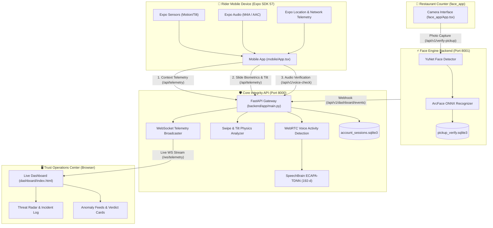

# Trust Juggler · Multi-Modal Rider Account Integrity & Merchant Pickup Verification

[](https://fastapi.tiangolo.com)
[](https://reactnative.dev)
[](https://speechbrain.github.io)
[](https://onnxruntime.ai)
[](https://developer.mozilla.org/en-US/docs/Web/API/WebSockets_API)
[](LICENSE)

An end-to-end, privacy-preserving defense platform built to combat **account renting, credential sharing, device spoofing, and pickup theft** across last-mile delivery networks. 

Trust Juggler replaces intrusive, high-friction checks (like constant selfie prompts or customer OTP friction) with a **continuous, 4-layer defense in depth** system combining passive contextual telemetry, motion sensor-fused swipe biometrics, deep speaker voice verification, and order-assigned merchant counter face verification.

---

## Table of Contents

- [System Architecture](#system-architecture)
- [The 4 Layers of Defense](#the-4-layers-of-defense)
  - [Layer 1: Network & Device Context](#layer-1-network--device-context)
  - [Layer 2: Behavioral Swipe Biometrics (Slide-to-Complete)](#layer-2-behavioral-swipe-biometrics-slide-to-complete)
  - [Layer 3: Passive Voice Biometrics (Call Customer)](#layer-3-passive-voice-biometrics-call-customer)
  - [Layer 4: Restaurant Counter Pickup Verification](#layer-4-restaurant-counter-pickup-verification)
- [Project Directory Structure ("What is Where")](#project-directory-structure-what-is-where)
- [Prerequisites](#prerequisites)
- [Step-by-Step Setup & How to Run](#step-by-step-setup--how-to-run)
  - [1. Backend Setup (Core Integrity API & Dashboard)](#1-backend-setup-core-integrity-api--dashboard)
  - [2. Pickup Face Verification Service](#2-pickup-face-verification-service)
  - [3. Mobile Application (Rider App)](#3-mobile-application-rider-app)
  - [4. Merchant Counter App (Face Verification)](#4-merchant-counter-app-face-verification)
- [Live Demo & Judging Runbook](#live-demo--judging-runbook)
- [API Reference](#api-reference)
- [Privacy, Safety & Calibration Notes](#privacy-safety--calibration-notes)

---

## System Architecture



---

## The 4 Layers of Defense

### Layer 1: Network & Device Context
- **Signals**: Public IP origin, cellular carrier connection, hardware fingerprint (`SM-G998B_Android_14_OEM`), and foreground GPS coordinates.
- **Detections**:
  - **Impossible Travel**: Velocity heuristics detecting teleportation between consecutive events.
  - **Mock Location**: Mock GPS provider flag detection in the mobile runtime.
  - **Device Mismatch**: Flags when a rider ID logs in from an unregistered or rogue hardware profile.

### Layer 2: Behavioral Swipe Biometrics (Slide-to-Complete)
Delivery apps require riders to "Slide to Complete Delivery". Rather than a simple boolean trigger, Trust Juggler profiles the physical gesture dynamics:
- **Trajectory Curve**: 4-point normalized vertical drift checkpoints ($Y$-axis deviation) compared against a personal envelope.
- **Timing & Symmetry**: Total swipe duration ($T_{total}$), midpoint duration ($T_{mid}$), and acceleration symmetry ratio ($T_{mid} / T_{total}$).
- **Sensor-Fused Tilt**: Mobile gyroscope and accelerometer capture pitch variation ($\Delta Pitch$) as the thumb presses and pushes across the glass.
- **Liftoff Dynamics**: Vertical liftoff velocity ($V_y$) at finger release.
- **Calibration**: Riders calibrate with 3 natural swipes to establish personal tolerances. Impostor swipes trigger step-up review.

### Layer 3: Passive Voice Biometrics (Call Customer)
- **Zero Customer Friction**: Never asks riders or customers for OTPs or PINs.
- **Enrollment**: 5 natural 10-second speech clips uploaded to `POST /api/v1/enrollments/batch-samples`.
- **Deep Feature Extraction**: SpeechBrain's `spkrec-ecapa-voxceleb` (ECAPA-TDNN) extracts 192-dimensional speaker embeddings.
- **Acoustic Preprocessing**: WebRTC Voice Activity Detection (VAD) strips silence and ambient noise while preserving native speech frequency bands.
- **Multi-Template Scoring**: Single 8-second clips from the masked bridge call are scored against all 5 enrolled embeddings. The **median cosine similarity** determines identity; shift-level call timelines track acoustic drift throughout a working shift.

### Layer 4: Restaurant Counter Pickup Verification
- **Targeted Order Matching**: Prevents unauthorized delivery partners or thieves from stealing orders at pickup counters.
- **Model Pipeline**:
  - **YuNet**: High-speed, lightweight face detector ensuring exactly one face is in frame.
  - **ArcFace (ONNX)**: 512-dimensional facial recognition embedding.
- **Assignment-Aware**: Compares the arriving driver's face *only* against the partner assigned to that specific order ID in the dispatch system.
- **Automated Routing**: Matches allow instant food release; mismatches or multi-face captures route directly to counter staff review and publish alerts to the Trust Operations dashboard.

---

## Project Directory Structure ("What is Where")

```
Hack_forge/
├── backend/                        # Core Trust Juggler API (Port 8000)
│   ├── app/
│   │   ├── main.py                 # FastAPI endpoints, WebSockets, telemetry & dashboard aggregator
│   │   ├── speaker.py              # SpeechBrain ECAPA-TDNN speaker verification engine
│   │   ├── audio_pipeline.py       # PyAV audio decoding, resampling & WebRTC VAD pipeline
│   │   └── shift_timeline.py       # In-memory per-shift acoustic drift tracker
│   └── README.md                   # Backend architecture & configuration notes
│
├── dashboard/                      # Real-time Trust Operations Center
│   └── index.html                  # Cyberpunk dark-theme command dashboard (WebSockets, Radar, Feeds)
│
├── mobile/                         # Rider Mobile App (Expo SDK 57 / React Native)
│   ├── App.tsx                     # 3 dedicated screens: Call Customer, Hardware/GPS, Complete Delivery
│   ├── index.ts                    # Expo entrypoint
│   ├── app.json                    # Permissions (Audio, Location, Sensors)
│   ├── package.json                # Dependencies (@expo/sensors, expo-audio, expo-location)
│   └── .env                        # Target backend URLs (LAN IP ports 8000 and 8001)
│
├── face_app/                       # Restaurant Counter Pickup Verification
│   ├── App.tsx                     # Expo camera interface for restaurant counter verification
│   ├── backend/                    # Dedicated ArcFace & YuNet FastAPI service (Port 8001)
│   │   ├── app/
│   │   │   ├── main.py             # Order lookup, face enrollment, verify & dashboard event forwarder
│   │   │   └── face_engine/        # OpenCV YuNet detector & ArcFace ONNX embedder
│   │   ├── scripts/
│   │   │   └── download-models.ps1 # Automatic ONNX model weight downloader & SHA checker
│   │   └── requirements.txt        # onnxruntime, opencv-python-headless, fastapi
│   └── README.md                   # Merchant counter system documentation
│
├── models/                         # Cached Machine Learning Weights (Git-ignored)
│   └── speechbrain-ecapa/          # Cached SpeechBrain VoxCeleb ECAPA-TDNN model
│
├── data/                           # Local Databases & Persistent Baselines (Git-ignored)
│   ├── account_sessions.sqlite3    # SQLite database for sessions & telemetry
│   └── baselines/                  # Serialized .npz rider enrollment embeddings
│
├── requirements.txt                # Root Python dependencies
├── requirements.lock.txt           # Pinned lockfile for reproducible Python 3.13 environments
├── DEMO_RUNBOOK.md                 # Live competition demo script and presentation notes
└── README.md                       # Master project documentation (this file)
```

---

## Prerequisites

- **Python**: Version 3.13 recommended (supports 3.11–3.13).
- **Node.js**: Version 18.x or 20.x with `npm`.
- **Package Managers**: `uv` recommended for ultra-fast Python setup (`pip install uv`), or standard `pip`.
- **Mobile Hardware**: Physical Android or iOS phone running the **Expo Go** app (pinned to SDK 57).
- **Network**: The computer hosting the backends and the physical phone must be connected to the **same Wi-Fi network**.

---

## Step-by-Step Setup & How to Run

### 1. Backend Setup (Core Integrity API & Dashboard)

Run from the repository root:

```powershell
# 1. Create Python virtual environment
uv venv --python 3.13 .venv --cache-dir .uv-cache

# 2. Install dependencies from lockfile
uv pip install --python .venv\Scripts\python.exe -r requirements.lock.txt --cache-dir .uv-cache

# 3. Configure environment
Copy-Item .env.example .env

# 4. Start the Core API on Port 8000
.venv\Scripts\python.exe -m uvicorn backend.app.main:app --reload --host 0.0.0.0 --port 8000
```

> **Note**: On first launch, the SpeechBrain model weights (~80 MB) download automatically from Hugging Face into `models/speechbrain-ecapa`. Ensure internet connectivity is active during first launch.

Open your browser to test:
- **Trust Operations Dashboard**: [http://localhost:8000/dashboard](http://localhost:8000/dashboard)
- **API Health**: [http://localhost:8000/health](http://localhost:8000/health)

---

### 2. Pickup Face Verification Service

In a **second terminal**, start the merchant counter face verification backend:

```powershell
# Navigate to face_app backend
cd face_app\backend

# 1. Create dedicated venv and install dependencies
py -3.13 -m venv .venv
.\.venv\Scripts\python.exe -m pip install -r requirements.txt

# 2. Setup environment & download ONNX models
Copy-Item .env.example .env
powershell -ExecutionPolicy Bypass -File .\scripts\download-models.ps1

# 3. Start the Face Service on Port 8001
.\.venv\Scripts\python.exe -m uvicorn app.main:app --reload --host 0.0.0.0 --port 8001
```

Confirm that `face_app/backend/.env` contains:
```ini
MATCH_THRESHOLD=0.45
DASHBOARD_API_URL=http://127.0.0.1:8000
DATABASE_PATH=./data/pickup_verify.sqlite3
```
This ensures verification events automatically stream into the Trust Operations Dashboard.

---

### 3. Mobile Application (Rider App)

Find your computer's local Wi-Fi IPv4 address using `ipconfig` (Windows) or `ifconfig` (macOS/Linux), for example `192.168.1.100`.

In a **third terminal**:

```powershell
cd mobile

# 1. Install Node dependencies
npm ci

# 2. Configure .env with your computer's LAN IP
# Replace with your actual LAN IP
Set-Content -Path .env -Value @"
EXPO_PUBLIC_API_BASE_URL=http://192.168.1.100:8000
EXPO_PUBLIC_PICKUP_API_URL=http://192.168.1.100:8001
"@

# 3. Start Expo in LAN mode
npx expo start --lan
```

Open the **Expo Go** app on your phone and scan the QR code displayed in the terminal.

---

### 4. Merchant Counter App (Face Verification)

If demonstrating counter face capture on a second phone or browser window:

```powershell
cd face_app
npm install
npx expo start --lan
```

Scan the QR code to open the restaurant pickup verification camera screen.

---

## Live Demo & Judging Runbook

Follow this workflow to showcase the full end-to-end multi-modal security pipeline:

| Step | Action | What to Show / Explain | Expected Outcome |
| :--- | :--- | :--- | :--- |
| **1. Baseline Setup** | Tap **Enroll Five Voice Samples** in Rider App. | Account holder records 5 distinct 10-second speech clips. | Model extracts 5 ECAPA embeddings (`sample_count: 5`). State is saved to `data/baselines/`. |
| **2. Gesture Calibration** | Switch to **Complete Delivery**, tap **Calibrate**, swipe 3 times. | Calibrates trajectory curve, speed, device tilt, and liftoff velocity. | Generates personalized tolerances (`curveEnvelopes`, `baselinePitchPush`). |
| **3. Legitimate Delivery** | Perform normal swipe and tap **Call Customer**. | Genuine rider's voice and natural swipe kinematics. | **Green GPay animation** triggers. Cosine similarity $> 0.25$. Dashboard shows **VERIFIED** status. |
| **4. Account Renting / Impostor Attack** | Hand phone to a colleague. Have them swipe and speak on **Call Customer**. | Simulates account sharing or rented delivery account. | Impostor's swipe fails drift/tilt envelopes. Impostor's voice similarity drops ($< 0.15$). **STEP-UP / ALERT** triggered. |
| **5. Device Spoofing** | Switch to **Hardware & GPS** screen; toggle **Mock Location** or **Rogue Device**. | Teleporting between distant coordinates or spoofing cellular telemetry. | Immediate high-severity alert pushed over WebSocket to the command center. |
| **6. Pickup Counter Verification** | Open Merchant Counter app (`face_app`), select an order, capture driver face. | Compares arriving partner against the order's assigned partner. | **Match**: Order released. **Mismatch / Multiple Faces**: Flags potential food theft, triggers staff review. |
| **7. Trust Operations** | Observe [http://localhost:8000/dashboard](http://localhost:8000/dashboard). | Live incident feed, multi-axis threat radar, signal breakdown, and manual alert triggers. | Full auditability of all behavioral, acoustic, and visual events. |

---

## API Reference

### Core Integrity API (Port 8000)

| Method | Endpoint | Description |
| :--- | :--- | :--- |
| `GET` | `/health` | Service health check |
| `POST` | `/api/v1/enrollments/batch-samples` | Accepts audio samples 0 to 4 to construct the 5-clip KYC baseline |
| `GET` | `/api/v1/enrollments/{rider_id}` | Check enrollment status, date, and baseline metadata |
| `POST` | `/api/v1/voice-check` | Verifies an 8-second customer call clip against the 5-clip baseline |
| `GET` | `/api/v1/shifts/{rider_id}/{shift_id}` | Returns acoustic drift timeline across the current work shift |
| `POST` | `/api/telemetry` | Ingests GPS, device hardware fingerprint, and swipe biometric telemetry |
| `POST` | `/api/alert` | Dispatches manual high-priority alerts to connected dashboard clients |
| `WS` | `/ws/telemetry` | Real-time WebSocket connection streaming tower state and incident logs |
| `POST` | `/api/v1/dashboard/events` | Receives and stores external events (e.g., from the pickup face service) |
| `GET` | `/dashboard` | Serves the web-based Trust Operations Command Center |

### Pickup Face Verification API (Port 8001)

| Method | Endpoint | Description |
| :--- | :--- | :--- |
| `GET` | `/health` | Face engine and model load status |
| `POST` | `/api/v1/partners/{partner_id}/enroll` | Enrolls a delivery partner's reference face template |
| `POST` | `/api/v1/verify-pickup` | Verifies camera photo against the partner assigned to `order_id` |
| `GET` | `/api/v1/orders` | Retrieves demo orders and assigned delivery partner metadata |

---

## Privacy, Safety & Calibration Notes

1. **Biometric Data Privacy**:
   - Raw facial photos and voice recordings are processed locally and discarded. Only 192-d or 512-d mathematical feature vectors are retained.
   - The Trust Operations Dashboard receives metadata, verdicts, and similarity scores; it **never receives raw facial images or voice recordings**.
2. **Zero Customer Burden**:
   - The system performs verification passively in the background. It never prompts delivery riders to ask customers for PINs, passwords, or OTPs.
3. **Demo Heuristics Notice**:
   - The default thresholds (`0.25` for voice match, `0.45` for face match) are provisional demo settings.
   - In production, thresholds must be calibrated against held-out validation datasets gathered under realistic street and vehicle acoustic conditions.
4. **Data Reset**:
   - To clear all stored SQLite sessions and swipe profiles, delete `data/account_sessions.sqlite3`.
   - To clear pickup face profiles, delete `face_app/backend/data/pickup_verify.sqlite3`.
   - To clear voice baselines, restart the FastAPI backend or remove files under `data/baselines/`.
